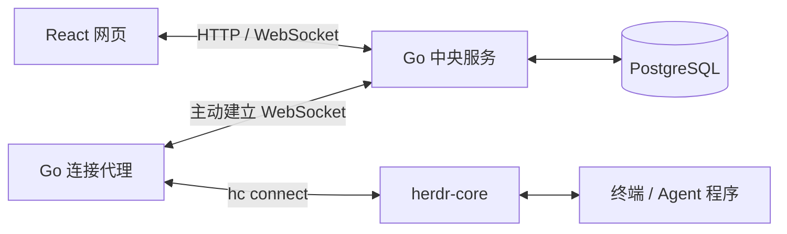

# Herdr Bridge

Herdr Bridge 将现有 herdr-core 接入浏览器，让用户通过自建服务访问多台机器上的终端与 Agent 工作台。支持账号隔离、机器管理、终端标签与分屏、只读观察、文件与变更浏览，以及网页布局保存。

- **多用户与多机器**：管理账号、连接 Key 和机器归属，用户只能访问自己的代理与终端。
- **网页终端**：通过浏览器操作终端，支持标签、分屏和只读观察。
- **Agent 工作台**：查看 Spaces / Agents，组织终端与网页私有空间。
- **文件与变更浏览**：查看聚焦终端目录下的文件和变更，支持 Markdown 预览。
- **布局保存**：保存网页布局，通过版本检查避免多个页面互相覆盖。
- **持续运行与重连**：关闭网页不结束终端程序，断线后可重新连接。

## 运行逻辑与架构

项目由 Go 中央服务、Go 连接代理和 React 网页组成，使用 PostgreSQL 保存账号、Key、代理归属和布局。每台需要接入的机器安装 herdr-core 的 `hc` 和连接代理；代理主动连接中央服务，无需修改 core，也无需给代理机器开放入站端口。

1. 管理员创建用户，用户登录网页后生成连接 Key。
2. 代理使用 Key 注册到中央服务，机器出现在所属用户的列表中。
3. 用户打开终端时，中央服务校验权限并建立隧道；每条浏览器连接对应独立的 `hc connect`，由代理转发输入、输出与状态。
4. core 负责终端和程序生命周期。关闭网页或连接断开只关闭查看连接；只有显式“结束程序”才终止程序。重连后重新获取状态，不重放输入或运行命令。

当前中央服务仅支持单实例部署。详细设计见 [架构方案](docs/architecture.md)，使用规则见 [使用说明与边界](docs/usage.md)；开发、配置、测试和发布资料统一收录于 [文档目录](docs/README.md)。

## 文档

[私有化部署](docs/deployment.md) · [完整文档](docs/README.md)
