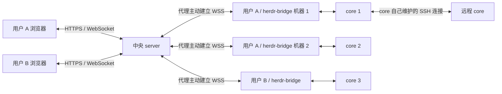

# Herdr Bridge 实施方案

状态：首版源码已建立，尚未完成全部环境验收；实际检查结果见 [验证记录](validation.md)。目标是在不修改 herdr-core 的前提下，通过主动出站的代理连接，实现多人使用、账号隔离、多机器选择的网页终端与 Agent 工作台。

当前范围聚焦功能开发。数据备份与恢复、运维监控、服务安装、自动部署和高可用暂不纳入实施与验收；后续需要时另行设计。保留配置启动、数据库迁移和页面/API 路由兼容性等功能必要约定。

## 1. 技术栈与代码组织

### 1.1 目录决策：单仓库、单 Go module、两个程序

server 和 client **必须使用 Go（Golang）实现**。两者统一在仓库根目录的一个 Go module 中，共享协议和传输代码，保留独立程序入口与业务目录。web-ui 使用独立的前端包和构建流程，与 Go 代码在同一仓库维护。

以下结构已在首版实现中建立；实现入口、配置和测试命令见 [根目录说明](../README.md)。

```text
herdr-bridge/
├── go.mod                # server、client 和共享包统一依赖管理
├── go.sum
├── docs/                 # 架构、协议与实施文档
├── server/
│   ├── main.go           # herdr-bridge-server 入口，仅负责启动装配
│   └── internal/         # HTTP API、用户认证、数据库、代理注册和路由
├── client/
│   ├── main.go           # herdr-bridge 入口，仅负责启动装配
│   └── internal/         # 配置、身份、重连、hc 子进程与隧道生命周期
├── internal/
│   ├── protocol/         # bridge 控制消息、版本、二进制封装及校验
│   └── transport/        # 双方实际共用的 WebSocket 读写与有界队列
├── contracts/
│   ├── openapi.yaml      # 浏览器 HTTP API 契约
│   ├── bridge/           # bridge 协议说明、消息 schema 和跨语言测试向量
│   └── core/             # 固定版本的上游 OpenRPC schema 及来源说明
├── web-ui/
│   ├── package.json
│   ├── package-lock.json
│   └── src/              # 页面、终端组件、API 调用和 core 协议客户端
└── examples/             # server YAML 和代理 JSON 配置示例
```

`client` 表示中央服务器的连接客户端；它本身是部署在机器上的后台服务程序，不是浏览器程序。后文称其为“代理”。代理仅主动连接中央服务器，不要求所在机器开放入站端口。

选择这一组织方式的原因：

| 方案 | 影响 | 决策 |
| --- | --- | --- |
| server/client 各自一个 Go module | 共享协议需要额外模块、版本发布或本地 replace，协议同步和 CI 更复杂 | 首版不采用 |
| 合成一个程序，通过子命令选择角色 | 部署角色、依赖和启动选项容易混杂，不能直接满足两个独立程序的命名与交付 | 不采用 |
| 一个 Go module，两个入口，共享 internal 包 | 协议修改可一次提交并统一测试，仍能独立构建和部署 | 采用 |

因此合并的是 Go 模块和公共代码，不需要把 server 与 client 的业务文件揉进同一个目录，也无需额外增加 backend 层级。保留原有三个主要目录，便于理解角色。根目录 internal 包可以被两个程序使用，server/internal 与 client/internal 利用 Go 的导入限制保护各自实现。

共享范围限于真正相同的协议、编解码和传输机制。数据库、用户认证、服务器路由留在 server；本机文件、代理身份和 hc 进程管理留在 client。两端不能互相导入业务包，也不预先创建通用 utils 或大而全的连接框架。

### 1.2 确定的技术栈

| 范围 | 技术选择 | 用途与理由 |
| --- | --- | --- |
| server、client | Go；实施时固定受支持稳定版本 | 同语言复用协议，独立二进制，便于常驻服务和跨平台发布 |
| HTTP 服务 | 标准库 net/http、ServeMux | API、静态资源和中间件；首版不引入大型 Web 框架 |
| WebSocket | github.com/coder/websocket | 两端共用，结合 context 管理取消、读写超时和关闭 |
| 日志与配置 | log/slog、encoding/json、go.yaml.in/yaml/v3 | 结构化日志；代理 JSON 与 server YAML 严格解析及配置校验 |
| 账号认证 | golang.org/x/crypto/argon2、crypto/rand、crypto/sha256 | 密码哈希、高熵 Key 和 Key 摘要；浏览器使用服务端会话 |
| 数据存储 | PostgreSQL（必选）、github.com/jackc/pgx/v5、pgxpool | 使用原生 PostgreSQL 驱动及连接池；客户端不连接数据库 |
| 数据库访问与迁移 | 参数化 SQL、版本化 PostgreSQL SQL 迁移 | 不引入 ORM；迁移由 server 管理并记录版本，通过 advisory lock 防止并发迁移 |
| Web 基础 | TypeScript strict、React、Vite | SPA 构建，类型检查，无需 SSR 或额外 Node 生产服务器 |
| Web 路由 | React Router | `/ui/` 下的登录、代理列表、工作台和管理页面 |
| 终端 | @xterm/xterm、@xterm/addon-fit | VT 渲染、键鼠输入与网格尺寸；性能验证后再增加 WebGL addon |
| 组件与样式 | Radix UI primitives、CSS Modules、CSS variables | 无障碍表单/弹层基础、局部样式与主题令牌，避免绑定后台模板 |
| 状态管理 | TanStack Query + React 本地状态/context | HTTP 数据缓存；连接、分屏、焦点等 UI 状态按工作台管理 |
| 布局分屏 | react-resizable-panels | 基础可调分屏，递归布局由业务层保存 |
| 测试 | Go testing/race、Vitest、Testing Library、Playwright | 协议、并发、组件及真实浏览器端到端验证 |

终端原始字节流直接写入 xterm.js，不放进 React 状态或 TanStack Query，避免大量输出触发组件重渲染。WebSocket 和 core 协议模块使用独立 TypeScript 类/函数，通过明确的订阅与销毁接口接入 React。

前端使用 npm 和 package-lock.json，CI 使用 npm ci。Go 通过 go.mod/go.sum 固定依赖，禁止发布时自动取 latest。实施开始时固定 Go、Node LTS 和库版本，并在 CI 与开发说明中保持一致。

### 1.3 协议复用与版本管理

- server/client 直接复用 internal/protocol 的消息类型、错误码、版本常量和二进制编解码，不各写一份。
- HTTP API 以 contracts/openapi.yaml 为契约，通过 openapi-typescript 生成前端类型；请求使用 fetch 封装，服务端通过契约测试验证响应。
- bridge 外层封装按字节规范实现 Go/TypeScript 编解码，使用同一组跨语言测试向量。控制消息 schema 与 Go 类型变更在同一提交更新并验证一致性。
- core 的 OpenRPC schema 从上游固定版本导入，并记录来源提交；它与 bridge 协议独立演进。终端流帧不由 OpenRPC 自动描述，需要另外维护解析器与测试。
- 单 Go module 只保证源码共享，不能假设部署中的两端总是同时升级。握手协商协议主版本和能力，遇到不兼容版本明确拒绝；新增可选字段保持兼容。
- 首版不引入 gRPC/Protobuf：现有 JSON 控制消息、二进制封装与 core 字节流已经满足需求，也可直接被浏览器消费。

### 1.4 构建与交付

建立入口后，在仓库根目录分别构建：

```bash
go build -o dist/herdr-bridge-server ./server
go build -o dist/herdr-bridge ./client
go test ./...

npm --prefix web-ui ci
npm --prefix web-ui run build
```

两个 Go 程序独立运行、独立部署和升级。客户端依赖图不得包含 server 的数据库、认证存储或 Web 页面；Go 只把入口实际引用的包编入对应程序。代理构建不需要 Node 或前端构建产物。

首版 server 发布包包含服务器二进制和可选的 web-ui/dist 目录，通过现有 web_ui.directory 配置提供静态文件；Nginx 部署时可单独发布该目录。暂不要求 go:embed，以免后端构建强依赖前端生成物。CI 分别检查两个 Go 入口构建、Go 测试、前端类型检查/构建以及协议契约一致性；并发测试在支持的平台运行 go test -race。

## 2. 系统拓扑



- server 管理账号、登录会话、用户 Key、代理归属、在线状态、访问授权和数据转发。
- web-ui 实现终端渲染、输入、Agent 状态、机器选择、标签与分屏。
- herdr-bridge 管理本机 core 连接，原样转发 core 协议，处理链路恢复。
- core 继续负责程序生命周期、终端历史、状态事件和远程机器连接。
- 浏览器连接多个代理时，每个代理是独立目标；终端标识必须包含 `bridge_id`，不能仅以 `t1` 或 `box/t1` 作为全局 ID。
- 一个代理下的远程 core 会话，通过已有 core 的终端聚合接口呈现，不额外要求在每个远程 core 上安装代理。

## 3. 多用户、admin 与用户 Key

### 3.1 用户与权限

首版不开放公开注册。提供 `admin` 管理员账号，用于创建、禁用用户、重置密码和查看连接元数据。普通用户只能访问自己拥有的 Key、代理和网页布局。

admin 默认不具备直接读取其他用户终端内容、附着终端或代用用户 Key 的权限。若以后需要代管，应设计显式授权及审计，而不是绕过归属检查。

浏览器通过用户名和密码登录，使用服务端会话 Cookie；密码使用 Argon2id 哈希保存。Cookie 设置 HttpOnly、生产环境 Secure、SameSite=Lax。修改状态的 HTTP 请求校验 CSRF Token；浏览器 WebSocket 校验会话及 Origin。用户 Key 不用于网页登录，不保存到浏览器 localStorage。

### 3.2 用户自己生成 Key

每个用户可以在网页生成多个 Key，建议每台代理使用独立 Key，也允许同一 Key 注册多台代理。

- Key 形式：`hbk_<公开标识>_<随机秘密>`。
- 随机秘密由操作系统安全随机源生成，至少 32 字节随机数据（256 bit），使用 base64url 无填充编码。安全性来自随机熵，不依赖人为组合特殊字符。
- 完整 Key 仅创建时显示一次；数据库保存公开标识、秘密摘要、所属用户、名称、创建时间、可选过期时间、最近使用时间、撤销时间。
- 高熵 Key 可使用 SHA-256 摘要保存并恒定时间比较；不能用该策略替代用户密码的 Argon2id 哈希。
- 支持创建、列出、撤销、轮换；列表只展示掩码，不返回完整秘密。
- 代理通过 `Authorization: Bearer <key>` 认证，禁止在 URL 查询参数中传 Key，日志必须脱敏。
- 撤销 Key 或禁用用户后，立即断开相关代理及浏览器隧道；关闭查看连接不会结束 core 中的程序。
- 首版不提供自动过期 Key 的秘密恢复；轮换需要生成新 Key 并更新代理配置。

### 3.3 代理身份与归属

代理首次启动生成随机 UUID，持久化到本地状态文件，重启后不变。服务器根据 Key 解析 `user_id`，原子地注册或验证 `bridge_id` 的归属；不信任代理上报的用户 ID。

一位用户可以注册多个代理、同时打开多个浏览器连接。同一代理可以服务该用户的多个浏览器标签页。同一 ID 重复在线时，首版拒绝新的代理连接并提示身份冲突，避免静默踢掉原连接。代理配置可以复制，但身份状态文件不应跨机器复制。

不同用户不能通过猜测 `bridge_id`、`tunnel_id` 或终端地址访问他人连接。每次列出、创建隧道、发送控制消息和重连都校验归属；代理 ID 不允许被其他账号重新认领。

## 4. 启动与配置

### 4.1 中央服务器 config.yaml

启动方式：

```bash
herdr-bridge-server --config /etc/herdr-bridge/config.yaml
```

拟定配置示例：

```yaml
server:
  listen: "127.0.0.1:8080"
  public_url: "https://bridge.example.com"
  allowed_origins:
    - "https://bridge.example.com"
  trusted_proxies: []

database:
  driver: postgres
  dsn_env: "HERDR_BRIDGE_DATABASE_URL"
  max_conns: 20
  min_conns: 2
  connect_timeout: "5s"
  query_timeout: "10s"
  max_conn_lifetime: "1h"

auth:
  session_ttl: "24h"
  cookie_secure: true
  bootstrap_admin:
    username: "admin"
    password_env: "HERDR_BRIDGE_ADMIN_PASSWORD"
    require_password_change: true

web_ui:
  enabled: true
  directory: "/opt/herdr-bridge/web-ui/dist"

connections:
  heartbeat_interval: "20s"
  heartbeat_timeout: "60s"
  max_bridges_per_user: 20
  max_tunnels_per_bridge: 16
  max_ws_message_bytes: 1048576
  max_buffer_bytes_per_tunnel: 4194304
```

以上数值作为首版默认建议，可调整。静态页面和 API 的路径为协议约定，不在首版支持任意改前缀。

数据库固定使用 PostgreSQL，不实现多数据库适配。通过 `dsn_env` 指定的环境变量读取连接串，例如 `postgresql://herdr_bridge:<URL编码后的密码>@db.example.com:5432/herdr_bridge?sslmode=verify-full`。生产环境配置可信 CA 并校验服务端证书；本机开发可显式使用 `sslmode=disable`。连接串不写入日志，数据库需提前创建并授予服务账号所需权限。server 启动时验证连接与迁移状态。

首次初始化空数据库时，必须从指定环境变量读取高强度管理员密码，不提供默认密码，也不把明文密码打印到日志。已有数据库启动时不重置 admin 密码。缺失首次初始化密码应明确报错退出。示例假设由 Nginx 终止 TLS；仅本机开发可关闭安全 Cookie。

### 4.2 代理 ~/.herdr-bridge/auth/config.json

默认配置路径固定为当前运行账号的 `~/.herdr-bridge/auth/config.json`；Windows 使用对应用户目录。以系统服务运行时，应明确服务账号和 HOME，避免误读其他用户配置。允许 `--config` 指定绝对路径。

```json
{
  "server_url": "https://bridge.example.com",
  "key": "hbk_REPLACE_WITH_USER_GENERATED_KEY",
  "name": "office-linux",
  "core": {
    "binary": "/home/example/.local/bin/hc",
    "session": "default",
    "socket": null
  },
  "connection": {
    "reconnect_min_seconds": 1,
    "reconnect_max_seconds": 600
  }
}
```

```bash
# 默认读取 ~/.herdr-bridge/auth/config.json
herdr-bridge

# 显式指定配置
herdr-bridge --config /path/to/config.json
```

- 从 HTTPS server_url 推导 WSS `/bridge/v1/connect`；HTTP/WS 仅供显式启用的开发模式使用。
- `core.binary` 是可执行文件路径，不是 shell 命令；使用参数数组启动，禁止将配置直接拼接为 shell 脚本。
- `core.session` 映射到 `HC_SESSION`；非空 `core.socket` 映射到 `HC_SOCKET`。代理构造确定的子进程环境，防止继承外部 HC_SOCKET 意外覆盖目标。
- 首版每个代理实例连接一个本地 core。需要连接另一个本地 core 时，用独立配置和状态路径运行另一个实例。
- 默认本地身份状态位于 `~/.herdr-bridge/state/identity.json`；允许 `--state-dir` 指定独立目录。使用文件锁阻止同一状态目录启动多个实例。
- Unix 下 auth 目录权限为 0700、配置文件为 0600；Windows 使用当前账号 ACL。配置内容与 Key 不进入日志或版本控制。
- 当前以前台命令启动常驻进程；systemd、Windows 服务集成及安装脚本暂不实现。

## 5. HTTP 与 WebSocket 路由

路由从第一版明确隔离，以支持 Nginx 同域部署和 server 直接提供静态页面。

| 路径 | 职责 | 认证 |
| --- | --- | --- |
| `/ui/`、`/ui/assets/*` | Web 页面和静态资源 | 页面加载后检查登录 |
| `/api/v1/auth/*` | 登录、登出、当前会话、修改密码 | 按端点校验 |
| `/api/v1/keys/*` | 当前用户的 Key 管理 | 用户会话 |
| `/api/v1/bridges/*` | 当前用户的代理列表、详情和状态 | 用户会话 |
| `/api/v1/layouts/*` | 当前用户的网页布局 | 用户会话 |
| `/api/v1/admin/users/*` | 用户管理 | admin 会话 |
| `/ws/v1/bridges/{bridge_id}` | 浏览器与指定代理的数据隧道 | 用户会话及代理归属 |
| `/bridge/v1/connect` | 代理主动连接的控制与数据通道 | 用户 Key |
| `/` | 重定向到 `/ui/` | 无 |

SPA fallback 仅作用于 `/ui/*`，不能让未知 API、代理路由或 WebSocket 路由返回 HTML。前端使用相对 API URL，WebSocket 地址根据页面协议推导，避免写死域名和端口。

### 页面托管模式 A：server 直接提供 web-ui

Vite 的 base 设置为 `/ui/`，构建产物交给 server 的 `web_ui.directory`。server 同端口提供静态页面、API 和 WebSocket；公网 TLS 可放在外层反向代理。

### 页面托管模式 B：一个 Nginx 下分开提供

- Nginx 提供 `/ui/*` 的静态资源和 SPA fallback。
- `/api/*`、`/ws/*`、`/bridge/*` 转发到 server，保留原始路径。
- WebSocket 转发设置 Upgrade、Connection，读超时大于心跳超时，并关闭相关代理缓冲。
- server 设置 `web_ui.enabled: false`。
- 首版推荐同域部署，不默认启用跨域 Cookie 或任意 Origin。

## 6. 代理连接协议

### 6.1 注册与心跳

1. 代理读取配置并验证本机 hc 可执行文件。
2. 代理携带用户 Key 发起 WebSocket 握手，server 校验 Key、账号状态和连接配额。
3. 代理发送 `register`：协议版本、bridge_id、展示名称、代理版本、操作系统及支持能力。不上传 Key 以外的本机秘密。
4. server 校验 ID 归属并回复 `registered`，分配此次连接的 `connection_id`。
5. 双方维护心跳。控制连接中断后，代理默认按 1、5、25、125、600 秒的间隔退避重连，达到上限后每 10 分钟重试一次；连接持续超过 1 分钟后断开则重置退避。
6. 在线状态区分“代理已在线”和“core 可用”；core 不可用时仍允许代理上线并报告脱敏错误。

用户 Key 无效、被撤销、身份冲突与协议版本不兼容属于明确错误，不应高速重试；配置修正或人工处理后恢复。

### 6.2 浏览器隧道

浏览器选择某个代理后，server 创建一个仅属于当前浏览器会话的 `tunnel_id`，通过代理连接发送 `open_tunnel`。代理为它启动独立的 `hc connect` 子进程，并把 stdin/stdout 接入隧道。

首版采用“一条浏览器数据连接 → 一个 tunnel → 一个 hc connect”，避免不同浏览器之间的 JSON-RPC 请求 ID 和 core channel ID 冲突。一个 tunnel 内可以利用 core 自身的多路通道附着多个终端，无需每个终端都启动一个子进程。

控制消息使用带版本的 JSON：`register`、`registered`、`open_tunnel`、`tunnel_opened`、`close_tunnel`、`tunnel_closed`、`error`。每次打开有请求 ID、超时和幂等处理；失败明确反馈 core 不可用、配额超限等原因。

数据消息使用二进制封装：`协议版本 u8 + 消息类型 u8 + tunnel UUID 16 bytes + payload`。数据封装与控制消息通过 WebSocket 消息类型区分；冻结实现前补充字节级规范及兼容测试。

浏览器只传递 core 字节流，server 不解释终端转义序列。代理的 stderr 单独收集并脱敏，绝不能混入 stdout 协议。tunnel 绑定当前 connection_id；重连后的新连接不接受旧隧道数据。

### 6.3 core 协议与流控

现有 core 先使用逐行 JSON-RPC，发送 `hello {"framed": true}` 后进入二进制帧模式。帧包含 channel、kind、length 和 payload；控制调用走 channel 0，终端流使用独立 channel，并有 CREDIT、RESIZE、FOCUS 等帧。

web-ui 内实现独立 TypeScript core 协议客户端，负责 hello、能力协商、RPC、terminal.attach、events.subscribe、终端输入与尺寸以及信用流控。

- WebSocket 消息边界不等于 core 帧边界。允许任意分片和合并，使用流式解码器；核心帧最大 16 MiB，而外层 WebSocket 消息可以更小。
- 终端输出交给 xterm.js 后，在写入完成回调中返回 CREDIT，不能仅在服务器收到数据时就回信用。
- 每个隧道设置有界队列。慢消费者超过限额时只关闭对应隧道，不能无限缓存，也不能阻塞其他用户。
- 代理与 server 对各隧道公平调度，控制帧优先。必要时关闭慢隧道以解除共享代理链路的阻塞。
- 协议解析限制长度、超时、RPC 并发及待响应数量；对无效帧关闭对应连接并记录脱敏原因。
- core 的终端恢复画面包含当前屏幕及按选项提供的历史，浏览器重新附着恢复，不依赖 server 缓存原始输出。

## 7. 网页功能范围

### 首版

- 登录、退出、首次修改管理员密码。
- admin 创建、禁用用户和重置密码。
- 用户生成、查看掩码、撤销自己的 Key，并获得代理配置示例。
- 列出自己的多个代理，显示在线、离线、core 不可用等状态。
- 选择代理，展示其本地与已聚合的远程终端、Agent 状态。
- 创建、附着、输入、调整尺寸、分离、显式结束终端。
- 多终端标签、基础分屏、断线重连和只读观察模式。

### 后续增强

- 更完整的空间管理、拖拽分屏、终端搜索与历史浏览。
- 多代理同时展示、Agent 树与状态筛选。
- 远程文件上传下载和受浏览器权限限制的剪贴板交互。
- 与原生 app 的布局同步、SSH 机器管理界面及其他 core 管理能力。

首版布局存中央数据库，按 user_id + bridge_id 隔离，多个页面通过版本号防止覆盖。暂不写入原生 app 的布局文档，以免不完整实现破坏原生布局。后续同步需研究 herdr-app 的 doc.get/doc.set 使用方式、布局 schema 和并发更新规则。

现有 GPUI Mods 不直接在浏览器运行，原生 app 的面板需要 Web 实现。xterm.js 与原生终端的行为不能默认视为完全一致：需验证中文输入、鼠标协议、粘贴、全屏 TUI、Windows ConPTY/win32-input-mode，以及终端能力声明。

## 8. 多人并发与生命周期

- 多人连接是多账号隔离；首版不开放跨账号共享代理。相同用户可以多窗口并发附着同一个终端。
- 多个可写查看端共同控制同一终端进程；core 按最近活跃查看端决定终端尺寸。界面提示共享输入状态，提供只读 observe 模式。
- 关闭网页、退出登录、网络断开、Key 撤销：关闭隧道和 hc connect 子进程，不发送 terminal.kill，不停止 core。
- 用户点击“结束终端”才调用 terminal.kill；“关闭标签/分离”与“结束终端”在 UI 上明确区分。
- 代理重连后，旧隧道全部失效。浏览器创建新隧道，重新 hello、订阅快照并附着仍存在的终端。
- core 重启或终端丢失时，以 core 实际返回的状态为准，不宣称原进程仍在运行。
- terminal.run、输入和文件写入等有副作用的操作，断线后不得自动重放；响应丢失时提示状态未知并刷新实际列表。
- server 重启后代理自动重连，数据库保存账号、代理归属与布局；在线连接状态从内存重新建立。

## 9. 数据模型与运行边界

建议首版表结构：

| 表 | 关键字段 |
| --- | --- |
| users | id、username（唯一）、password_hash、role、status、must_change_password |
| sessions | session_token_hash、user_id、expires_at、revoked_at |
| api_keys | id、public_id、secret_hash、user_id、name、expires_at、revoked_at、last_used_at |
| bridges | id、user_id、name、首次注册时间、最近连接时间、版本与系统信息 |
| layouts | id、user_id、bridge_id、version、document |
| audit_events | actor、action、target、result、timestamp |

当前代理连接使用的 key_id 与 connection_id 保存在连接注册表中，支持立即撤销。审计记录登录、Key 管理、代理注册、隧道开关和显式管理操作，不默认记录终端输入、输出、密码或 Key。

首版 server 单实例部署，PostgreSQL 持久化，内存维护 WebSocket 路由。Nginx 不将请求随机分配给多个 server 实例。PostgreSQL 可以独立部署，但共享数据库本身不能解决在线连接路由和跨实例 Key 撤销通知；水平扩展仍需要连接定位、跨实例转发和事件广播，不属于首版能力。

数据表使用 PostgreSQL 原生 UUID、timestamptz 和必要的 JSONB（如布局 document），归属关系设置外键，用户名和 Key 公开标识设置唯一约束。代理注册、首次 admin 初始化等并发敏感操作使用事务及数据库约束，避免仅依赖应用层先查后写。

保留版本化数据库迁移，用于建立和升级业务表结构。服务启动校验迁移和配置版本，失败时明确退出，不静默忽略未知的关键配置。

## 10. 实施阶段与验收

### 阶段 1：验证端到端终端链路

首先建立根目录单 Go module、server/client 两个入口、共享协议包和 web-ui 工程，固定工具链与依赖版本，加入构建和协议测试。随后实现最小 server、代理出站连接、浏览器连接和 hc connect 转发；配置具备最小认证，不发布无认证公网原型。

验收：网页列出真实 core 终端，打开 shell，输入并看到输出，调整尺寸；断开网页后 shell 继续运行；重新附着恢复画面。整个过程使用隔离 HC_SESSION，不接触开发者正在运行的终端。

### 阶段 2：多用户与代理管理

实现 config.yaml、admin 初始化、登录会话、用户管理、Key 生成撤销、config.json 启动、代理身份注册和多代理列表。

验收：两个账号只能看见和连接各自代理；同一账号能选择至少两台代理；篡改 bridge_id/tunnel_id 被拒绝；撤销 Key 立即断开相关链路且 core 任务存活。

### 阶段 3：可日常使用的 Web UI

实现标签、基础分屏、Agent 状态、只读附着、重连状态和布局保存。

验收：多个浏览器同时使用；慢页面不阻塞其他隧道；中文输入、常用全屏 TUI、粘贴和 resize 可用；core 故障后显示真实状态；非幂等操作不自动重放。

### 阶段 4：功能集成与可靠性

完成 server 静态页面托管、前后端路由集成、数据库迁移、连接配额及功能审计。保留 Nginx 托管的路由兼容约定，暂不交付运维部署脚本。

验收：server 托管页面可用，静态构建产物可以独立提供且路径与 API 隔离；未知 API 不返回 SPA 页面；Cookie、Origin、CSRF 和 WebSocket 正常；server/代理重启恢复连接；大输出和网络抖动下内存保持有界。

## 11. 后续代码实现必须覆盖的测试

- core 帧拆包/粘包、畸形长度、超限帧、RPC 并发与 CREDIT 流控。
- 两用户、两代理、同用户多浏览器的授权与隔离。
- Key 过期/撤销、用户禁用、重复代理身份和连接配额。
- 浏览器、server、代理、hc connect 各自断开后的资源清理与恢复。
- 断开连接不杀终端；显式结束才杀终端；未知执行结果不自动重试。
- 慢消费者、大输出、多个隧道竞争时的缓冲上限与公平性。
- 原生 core 隔离会话的端到端测试，以及浏览器终端行为测试。
- PostgreSQL 集成测试使用隔离测试数据库，覆盖迁移、唯一约束、事务回滚、并发注册和连接池超时，不以 SQLite 替代。

## 12. 参考依据

- `herdr-core/schema/README.md`：JSON-RPC、framed 模式、attach、事件、信用流控。
- `herdr-core/docs/machines.md`：本地 core 聚合远程终端及连接语义。
- `herdr-core/docs/security.md`：本地端点、状态目录及访问权限。
- `herdr-app/src/hc.rs`：原生 app 启动 hc connect 的实现。
- `herdr-app/src/layout_sync.rs`：后续原生布局同步的研究入口。
