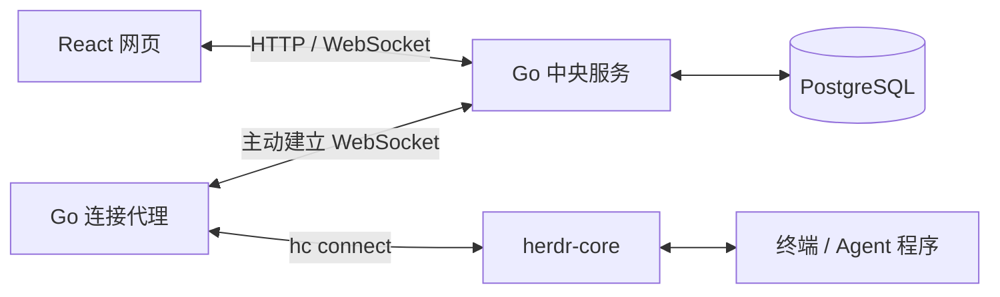

# 运行逻辑与架构

[返回文档目录](README.md) · [返回项目说明](../README.md)

项目由 Go 中央服务、Go 连接代理和 React 网页组成，使用 PostgreSQL 保存账号、Key、代理归属和布局。每台需要接入的机器安装 herdr-core 的 `hc` 和连接代理；代理主动连接中央服务，无需修改 core，也无需给代理机器开放入站端口。

1. 管理员创建用户，用户登录网页后生成连接 Key。
2. 代理使用 Key 注册到中央服务，机器出现在所属用户的列表中。
3. 用户打开终端时，中央服务校验权限并建立隧道；每条浏览器连接对应独立的 `hc connect`，由代理转发输入、输出与状态。
4. core 负责终端和程序生命周期。关闭网页或连接断开只关闭查看连接；只有显式“结束程序”才终止程序。重连后重新获取状态，不重放输入或运行命令。

当前中央服务仅支持单实例部署。详细设计见 [架构方案](architecture.md)，使用规则见 [使用说明与边界](usage.md)；开发、配置、测试和发布资料统一收录于 [文档目录](README.md)。
